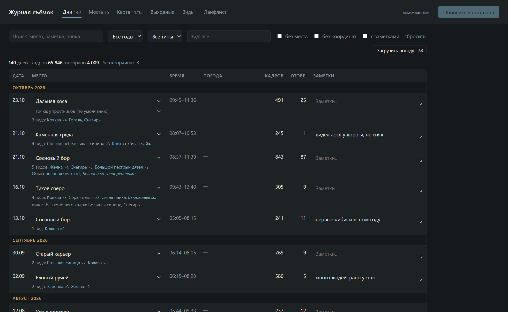
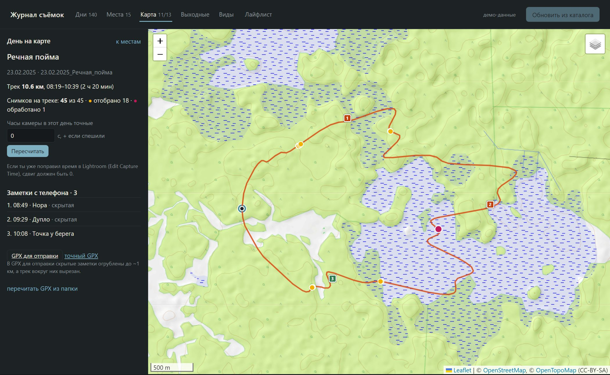
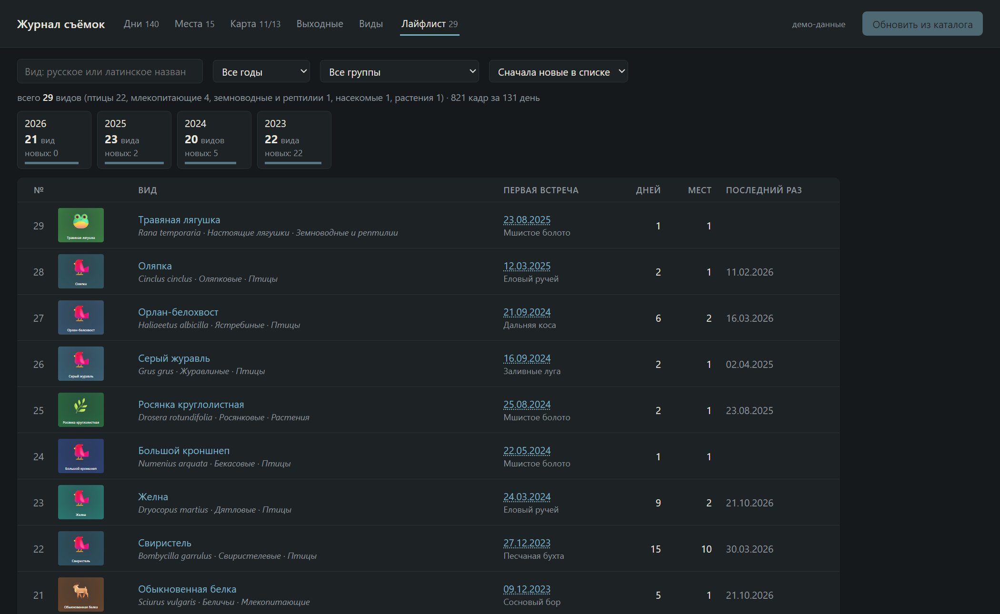
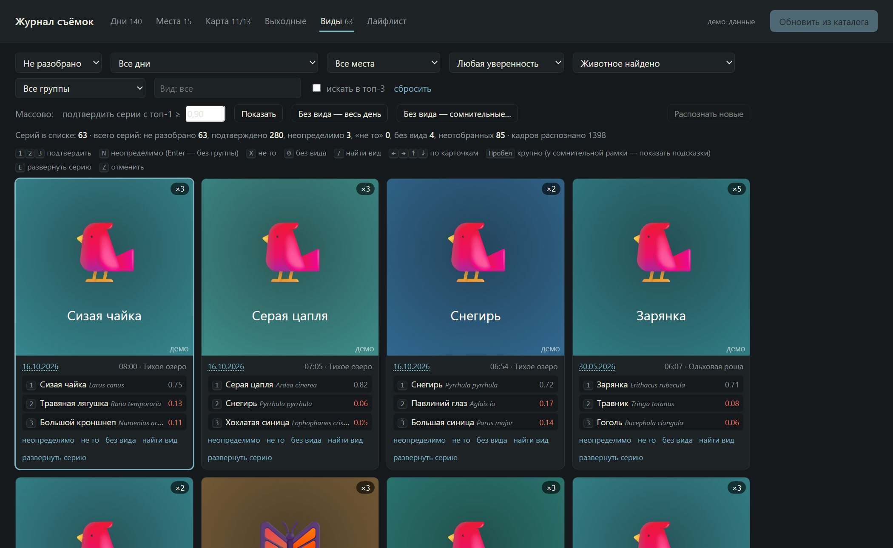
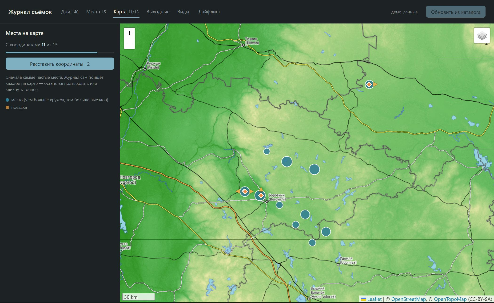

# 📷 Журнал съёмок

Личный журнал выездов для фотографа дикой природы. Сам собирает историю съёмок из каталога Lightroom Classic: дни, места, кадры, отбор. Подтягивает погоду, треки и заметки с телефона, распознаёт виды на твоих кадрах и ведёт лайфлист — чтобы планировать следующие выезды на основе своего же опыта.

**Ничего не уходит с компьютера:** приложение работает локально, каталог Lightroom и файлы снимков только читаются, распознавание идёт на твоей видеокарте. Для фотографов, которые не раскрывают свои места, это принципиально.

FastAPI · SQLite · HTML/JS без сборки · Leaflet · BioCLIP-2 + MegaDetector (необязательно)

> Статус: MVP в разработке, версия 0.x. Что изменилось — в [CHANGELOG](CHANGELOG.md).



<table><tr>
<td></td>
<td></td>
</tr><tr>
<td></td>
<td></td>
</tr></table>

<sub>Скриншоты на демо-данных: места, выезды, треки и находки выдуманы, вместо превью кадров — заглушки.</sub>

## Что уже умеет

**Дни и места**
- Читает каталог Lightroom: время съёмки, пути к файлам, рейтинг. Дубли с внешних дисков отфильтровываются.
- Собирает съёмочные дни и места из имён папок (`23.10.2026_Северный_мыс` → Северный мыс). Понимает разные форматы дат, диапазоны дней и опечатки. Правила в `locations.txt`: синонимы, составные названия через «+», типы «место / поездка / не место».
- Точки внутри места — например, две стороны мыса — с направлением берега: журнал понимает, ветер «в лицо» или «в спину».
- Погода и солнце по каждому дню (архив Open-Meteo): ветер, облачность, осадки, восход и закат, где было солнце во время съёмки.
- «Выходные»: места, где ты бывал в эти недели прошлых лет, с прогнозом и твоим удачным днём с самой похожей погодой. Там же — виды, которые ты подтверждал на месте в это время года, и наблюдения iNaturalist рядом.

**Поле: трек и заметки с телефона**
- GPX из папки дня — трек на карте, координаты кадров по треку с учётом сдвига часов камеры (журнал подскажет сдвиг сам).
- Точки с телефона (норы, дупла, гнёзда) — заметки на карте дня. По умолчанию скрытые: в «GPX для отправки» они огрублены до ~1 км, а трек вокруг вырезан.

**Виды — распознавание с подтверждением**
- MegaDetector находит животное, BioCLIP-2 предлагает три вида по кропу из превью Lightroom. Только виды, которые встречаются в твоём регионе по iNaturalist; для поездок — свой список.
- Вкладка «Виды»: кадры одной встречи склеены в серии, подтверждение одной клавишей, массовое подтверждение уверенных серий с предпросмотром, «неопределимо» с родом или семейством («Чайки sp.»).
- Подсказки учатся на твоих решениях: подтверждённые кадры становятся образцами для похожих.
- После «Обновить из каталога» новые кадры распознаются сами в фоне, с паузой при перегреве видеокарты. Новые дни — целиком, включая кадры без звёзд: такие виды попадают в карточку дня как «видел, без хорошего кадра».

**Лайфлист**
- Только подтверждённые тобой виды: первая встреча каждого (дата, место, первый кадр), разбивка по годам и группам, сколько новых за год.
- Места и месяцы: таблица «вид × месяц» для места — кого и когда здесь ждать.
- Виды в карточке дня и фильтр дней по виду: «в какие дни я снимал оляпку».

## Локальный запуск

Нужен Python 3.12. На Windows — через WSL (Ubuntu).

```bash
python3 -m venv .venv && .venv/bin/pip install -r requirements.txt
cp config.example.json config.json       # указать путь к своему каталогу Lightroom
cp locations.example.txt locations.txt   # необязательно: правила для мест
./run.sh                                 # → http://localhost:8765
```

В интерфейсе нажать «Обновить из каталога» — журнал прочитает каталог. Повторная синхронизация подтягивает новые съёмки и не трогает ручные правки: заметки, назначенные места, подтверждённые виды.

### Посмотреть без своего каталога Lightroom

```bash
python3 scripts/make_demo.py            # data/demo.db: выдуманные места, выезды, треки и виды
JOURNAL_DB=data/demo.db ./run.sh        # журнал на демо-базе, синхронизация с каталогом отключена
```

### Распознавание видов (необязательно)

Нужна видеокарта NVIDIA; зависимости — отдельным файлом, журнал работает и без них.

```bash
.venv/bin/pip install -r requirements-species.txt
.venv/bin/python -m app.species region   # региональный список видов iNaturalist (один раз)
.venv/bin/python -m app.species run      # первый прогон; дальше — само после синхронизации
```

`python -m app.species status` — что сделано и что в очереди, `rescore` — пересчитать подсказки за секунды без повторного чтения превью.

### Папка дня

```
ДД.ММ.ГГГГ_Место\
  <подпапки импорта Lightroom>\   NEF
  Трек\          GPX (ищется и в корне дня)
  С телефона\    фото-заметки с телефона
  Видео\, Аудио\ пока не читаются
```

Подпапки необязательные. Журнал в папку ничего не пишет.

### config.json

| Поле | Что это |
|---|---|
| `catalog_path` | Путь к `.lrcat`. Из WSL диск C: виден как `/mnt/c/...` |
| `root_priority` | Порядок дисков, если одна и та же папка есть на нескольких (дубли) |
| `exclude` | Части путей, которые не учитывать: экспорт, чужие папки |
| `path_prefix` | Учитывать только фото из этой папки |
| `path_map` | Свои соответствия путей Windows → WSL, если диск виден не как `/mnt/<буква>` |
| `utc_offset_h` | Часовой пояс времени съёмки (для GPX, который в UTC). По умолчанию 3 |
| `species_auto` | `false` — не запускать распознавание после синхронизации |
| `species_scope` | `"all"` (по умолчанию) — все кадры новых дней, `"selected"` — только ★2+ |
| `species_region` | `[swlat, swlng, nelat, nelng]` — свой прямоугольник региона для списка видов |

## Приватность

- Каталог Lightroom, NEF и XMP только читаются. Координаты, виды и заметки живут в базе журнала (`data/journal.db`, не в git).
- Наружу уходит только необходимое: Open-Meteo — координаты мест для погоды и прогноза, iNaturalist — прямоугольник региона, огрублённый до целых градусов, и точки мест для «видов рядом», OpenStreetMap Nominatim — названия мест, когда ищешь им координаты, серверы карты — плитки того участка, который ты смотришь.
- Скрытые находки при выгрузке огрубляются до ~1 км, трек вокруг них вырезается.

## Структура

```
app/main.py        API (FastAPI)
app/lrcat.py       чтение каталога Lightroom
app/sync.py        синхронизация каталога → журнал
app/locations.py   места из имён папок + правила из locations.txt
app/weather.py, app/sun.py, app/plan.py   погода, солнце, «Выходные»
app/field.py       GPX, координаты кадров по треку, находки, безопасная выгрузка
app/species.py     распознавание: превью → MegaDetector → BioCLIP-2, региональный список iNat
app/review.py      вкладка «Виды»: серии, решения, кропы
app/lifelist.py    лайфлист и аналитика по подтверждённым видам
app/inat.py        наблюдения iNaturalist рядом с местом
static/index.html  весь интерфейс, без сборки
scripts/           make_demo.py — демо-база, scan_catalog.py — как разбираются папки
```

## Дальше

- Ключевые слова видов и GPS в Lightroom через Lua-плагин — журнал по-прежнему сам ничего в каталог не пишет.
- Цели и проекты: цепочка «слышал → разведка → видел → снял», фенология по своим данным.
- Видео из папки дня на шкале и карте, звук через BirdNET — виды по голосам в тот же список дня.
- Литораль и уровень воды, карточка места, установщик с мастером первого запуска.
